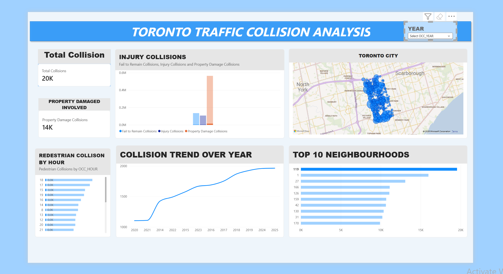

# Toronto Traffic Collision Analysis (Power BI)

## Overview
Power BI report analyzing City of Toronto traffic collision data to answer core safety and severity questions, highlight peak pedestrian collision hours, and visualize spatial collision patterns.

## Dataset
- **Source:** City of Toronto Open Data Portal — Police Annual Statistical Report: Traffic Collisions (`https://open.toronto.ca/dataset/police-annual-statistical-report-traffic-collisions/`)

## Data Preparation & Modeling
- Cleaned and standardized data types in Power Query (dates, text indicators, and decimal latitude/longitude fields `LAT_WGS84` and `LONG_WGS84`).
- Created a dedicated `_Measures` table with DAX measures (`Total Collisions`, `Injury Collisions`, `Fail to Remain Collisions`, `Property Damage Collisions`, and `Pedestrian Collisions`).

## Key Questions Addressed
1. **Total Collisions:** Reported headline collision volume via KPI card.
2. **Breakdown by Injury Type:** Compared injury, fail-to-remain, and property damage collisions.
3. **Pedestrian Collisions by Time of Day (`OCC_HOUR`):** Identified hour `18` (6:00 PM) as the peak hour for pedestrian-involved collisions.
4. **Additional Visuals & Map:** Added yearly collision trends (`OCC_YEAR`), Top 10 neighbourhoods (`HOOD_158`), and a map using `LAT_WGS84` and `LONG_WGS84`.

## Dashboard Preview

(MapShowingCollision.png)
